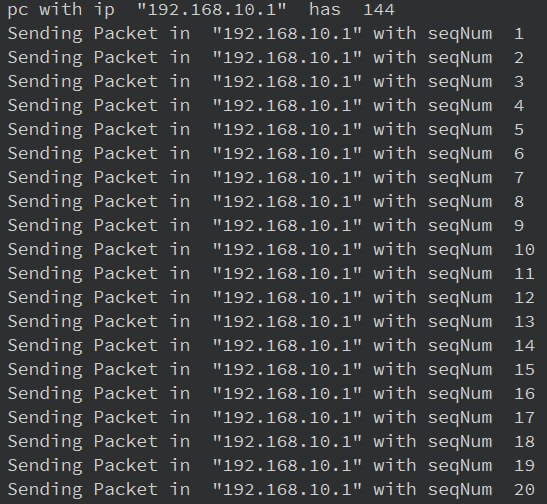
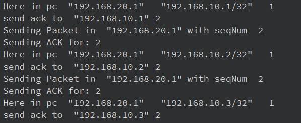
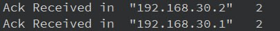
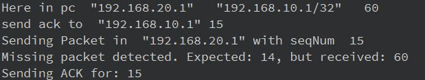

Computer Networks - CA4 - Fall1403

Arshiya Ataei - Mobina Haghizadeh

------------------------------------------------------------------------------------------------------

## Project Overview

This project involves a network simulator developed for a computer networks course, focusing on the dynamic interactions between routers and PCs within various network topologies. The simulator is implemented in C++ using Qt6 and is designed for Linux systems. It features complex routing protocols such as iBGP, eBGP, RIP, and OSPF, and supports both IPv4 and IPv6 networks. Routers are pre-configured with static IPs, while PCs acquire their IPs dynamically through DHCP.

The core challenge of the project is to implement and test the TCP NewReno algorithm under simulated network conditions, including traffic congestion similar to torrent systems. This is to observe the performance of network congestion control mechanisms and the efficiency of data transmission. The simulation runs across multiple threads, with an EventHandler managing the synchronization, providing a robust platform for studying and enhancing network protocol implementations in a controlled environment.

-------------------------------------------------------------------------------------------------------
# TCP Sender Logic

The sender side of our TCP simulation includes handling acknowledgments effectively to adjust the congestion window (cwnd) and ensure efficient packet delivery. Here’s how the sender side logic operates:

1. Acknowledgment Reception:

The ackReceived function processes received ACKs to update the congestion window and the state of packets awaiting acknowledgment. If the ACK number is greater than the last acknowledged number (lastAckNumber), it implies successful reception of packets up to the ACK number, which prompts updates to the congestion window based on the current phase of TCP (slow start or congestion avoidance).
If three duplicate ACKs are received (dupAckCount == 3), it signifies packet loss, triggering a fast retransmission. The congestion threshold (ssthresh) is halved, and the congestion window is set slightly above the threshold to probe for usable bandwidth.

2. Packet Transmission:

The sendTcpPackets function is invoked periodically (each tick) to manage packet transmissions based on the state of the network and the sender's window. It attempts to send new packets if the congestion window and retransmission timeout (rto) conditions allow, ensuring that packets are sent in accordance with TCP flow and congestion control requirements.

3. Congestion Window Management:

The sender adjusts the congestion window based on network conditions reflected by ACKs. During slow start, the window grows rapidly, increasing by the number of acknowledged packets. In congestion avoidance, growth is more conservative, increasing slowly to prevent congestion.
On triple duplicate ACKs, indicating a packet loss, the window size is reduced dramatically to slow start threshold levels, and slow start is re-entered to cautiously probe for bandwidth.

4. Flow and Error Control:

The system manages packet flow by maintaining a count of packets "in flight" and adjusting sending behavior based on the ACKs received and the estimation of network conditions. It also handles timeouts by retransmitting packets when acknowledgments are delayed beyond the expected timeout interval.

The implemented TCP logic ensures robust handling of network dynamics, supporting both efficient data transfer and congestion control. This approach not only aids in understanding TCP behavior but also enhances the reliability and performance of the network simulator in replicating real-world networking scenarios.  

----------------------------------------------------

# TCP Receiver Logic

In the network simulator, the TCP receiver logic is crucial for managing data integrity, flow control, and providing feedback to senders about the state of transmitted data. The receiver side ensures that packets are received in order and acknowledges the successful receipt of data packets, thereby playing a vital role in the congestion control mechanism.

1. Packet Processing:

When a packet arrives, the processPacket function first checks if the packet has already been received by inspecting its sequence number. This prevents the processing of duplicate packets, ensuring that only new packets are considered for further actions.

2. Sequence Number Management:

The processTCPpacket function is called for every new TCP packet. It maintains a record of received sequence numbers for each sender, using a map where keys are sender IPs and values are sets of sequence numbers. This structure helps in efficiently checking for missing or out-of-order packets.
Upon receiving a new packet, its sequence number is inserted into the appropriate set. If the insertion is successful (indicating a new, non-duplicate packet), the packet is acknowledged.

3. Acknowledgment Handling:

After updating the sequence number records, the receiver calculates the next expected sequence number. If the current packet's sequence number is less than the next expected number, it indicates a gap due to missing packets. This triggers a retransmission request by sending an ACK for the last correctly received packet.
ACKs are sent even for correctly received packets, updating the sender about the highest sequence number received in order. This helps the sender adjust its sending window and manage flow control effectively.

4. Error and Flow Control:

The receiver identifies missing packets and quickly notifies the sender, which helps in maintaining smooth data flow and quick recovery from packet losses.
By managing acknowledgments accurately, the receiver supports the sender in optimizing the transmission speed and preventing network congestion.

The implementation of TCP receiver logic in our network simulator is designed to handle data transmission accurately and efficiently. By ensuring data integrity through sequence number checks and enhancing communication reliability via timely acknowledgments, the receiver side of TCP plays a pivotal role in the simulation's ability to mimic real-world network behaviors. This setup not only aids in educational purposes but also in the research and testing of network protocols in a controlled environment.

---------------------------------------------------------------------------------------------------------

# Comparing the three TCP algorithms—TCP NewReno, TCP Vegas, and TCP Veno

## TCP NewReno
TCP NewReno is an improvement over TCP Reno, addressing some of the deficiencies in Reno's fast recovery algorithm. When a timeout occurs, NewReno retransmits the lost packet and enters a phase called Fast Recovery. During Fast Recovery, it infers the receipt of a packet based on the arrival of duplicate ACKs and reduces its congestion window only once per window of data, which helps in achieving better throughput and stability in a network with high packet loss.

### Strengths:

Handles multiple packet losses better than TCP Reno without additional round trips.
Recovers faster from packet losses without waiting for a retransmit timeout as often.
### Weaknesses:

Performance can degrade during high variance in round-trip times or in highly congested networks.

## TCP Vegas
TCP Vegas detects congestion before packet loss occurs by measuring the difference between expected and actual throughput, thereby preventing congestion. It adjusts the congestion window proactively based on this early detection, which can lead to better throughput and less variability in connection performance.

### Strengths:

Efficient in networks where packet loss is not a reliable indicator of congestion.
Tends to maintain a more stable throughput due to proactive measures.

### Weaknesses:

Can be unfair to Reno-like flows in mixed environments as Reno-like flows are more aggressive.
Performance may degrade in lossy networks where loss does not correlate with congestion.

## TCP Veno
TCP Veno combines the features of TCP Reno and TCP Vegas. It operates like Vegas in detecting network congestion before packet losses occur but switches to a Reno-like mode during periods of actual packet loss. This makes it suitable for environments with a mix of high bandwidth-delay product and random losses, such as wireless networks.

### Strengths:

Balances between the aggressive nature of Reno and the conservative approach of Vegas.
Performs well in networks with both congestion and random loss.

### Weaknesses:

Complexity in switching between algorithms can lead to suboptimal performance in extremely variable network conditions.
May not outperform Reno or Vegas in their ideal conditions due to compromise in operational tactics.

Each of these algorithms has its advantages and is suited to particular network conditions. NewReno is robust in handling multiple losses in traditional wired networks, Vegas excels in early congestion detection and bandwidth estimation, and Veno provides a hybrid solution beneficial in networks with mixed characteristics. The choice of TCP algorithm can significantly impact the efficiency and reliability of data transmission, depending on the underlying network infrastructure and traffic characteristics.

---------------------------------------------------

### In the accompanying figures, the TCP packet transmission and acknowledgment process is illustrated using four distinct screenshots, each representing a different phase of the network activity.

Figure 1 provides an overview of the initial condition where the PC is required to send a total of 144 packets. Initially, the congestion window (cwnd) is set at 20, allowing the transmission of the first 20 packets.

Figure 2 shows the reception of packets at the destination. The packet with sequence number 1 has been successfully received, prompting the system to generate an acknowledgment (ACK) for sequence number 2, indicating readiness to receive the next packet.

Figure 3 captures the moment when acknowledgments for the sent packets are received back at the source. This step is crucial as it confirms the successful delivery of packets and informs the sender about the status of packet transmission.

Figure 4 details an instance where packet loss is observed. This screenshot highlights the gaps in sequence numbers of received packets, signaling missed packets during transmission. This scenario necessitates the retransmission of the missing packets to maintain the integrity and completeness of the data transfer.

Each figure significantly contributes to understanding the dynamic interactions and operations within TCP-based communications, emphasizing the mechanisms of packet sending, acknowledgment, and error handling in network protocols.
